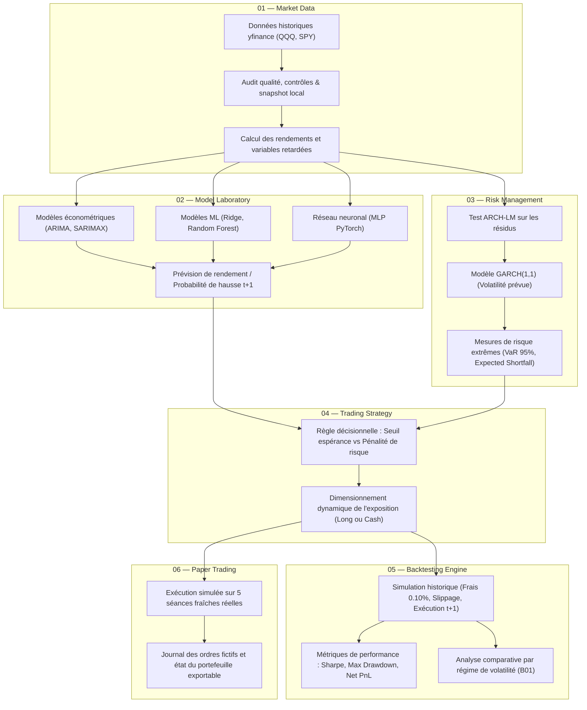

# QUANT LAB — Projet Intégrateur : Trading Intelligent

> **Projet de cours :** Trading Intelligent  
> **Auteur et responsable pédagogique :** Pr. Tawfik Masrour  
> **Département d'informatique — Faculté des Sciences — Université Mohammed V, Rabat**  
> **Édition :** Novembre 2026  
> **Variante attribuée :** **B01 · QQQ — Grandes entreprises du Nasdaq-100**

---

## 1. Identification du binôme et cadrage général

* **Binôme :**
  * **Étudiant 1 :** [Nom Prénom] — [Email universitaire / CNE]
  * **Étudiant 2 :** [Nom Prénom] — [Email universitaire / CNE]
* **Rôle de l'équipe :** Équipe de recherche et d'ingénierie quantitative.
* **Mission :** Concevoir une application Web interactive sous **Streamlit**, modulaire, reproductible et scientifiquement défendable, couvrant l'ensemble de la chaîne de valeur du trading quantitatif : de l'ingestion des données de marché à la simulation de trading (backtest et paper trading).

---

## 2. Périmètre des actifs financiers

* **Actif principal étudié :** `QQQ` (*Invesco QQQ Trust*).
  * Représente les 100 plus grandes entreprises non financières cotées au Nasdaq (forte prédominance technologique et valeurs de croissance : Apple, Microsoft, NVIDIA, Amazon, Alphabet, Meta, etc.).
  * Actif très liquide mais sujet à une forte volatilité conditionnelle et à des régimes de marché alternant forte expansion et corrections brutales.
* **Instrument de comparaison (Benchmark commun) :** `SPY` (*SPDR S&P 500 ETF Trust*).
  * Benchmark de référence du marché actions américain large, utilisé pour mesurer la surperformance relative et servir de variable exogène.
* **Fréquence et conventions :** Données journalières ajustées (OHLCV), décisions prises après la clôture $t$, exécution à l'ouverture $t+1$.

---

## 3. Problématique et question scientifique (Spécifique B01)

* **Question de recherche :**
  > *Les modèles anticipant le risque améliorent-ils les décisions sur un ETF technologique volatil ?*
* **Hypothèse scientifique :**
  Sur un actif à forte volatilité comme le QQQ, une stratégie purement directionnelle (cherchant uniquement à prédire la hausse ou la baisse des prix) s'expose à des drawdowns sévères lors des retournements de tendance. Intégrer un modèle de prévision de la volatilité (famille GARCH) pour piloter dynamiquement la taille de la position (*position sizing*) ou forcer un repli tactique en liquidités (*Cash*) permet d'améliorer le ratio de Sharpe et de préserver le capital net de frais.
* **Expérience distinctive imposée :**
  Comparer rigoureusement la performance des stratégies de trading selon deux régimes :
  1. Périodes de **faible volatilité récente** (régime haussier/calme).
  2. Périodes de **forte volatilité récente** (régime turbulent/stress de marché).
* **Angle de discussion final :**
  Prévision de volatilité conditionnelle, seuils de Value-at-Risk (VaR) / Expected Shortfall (ES), et efficacité du contrôle dynamique de l'exposition par rapport à un *sizing* fixe ou un Buy & Hold passif.

---

## 4. Cadre opérationnel et règles méthodologiques

* **Capital initial simulé :** $100\,000\text{ USD}$ virtuels (aucun argent réel).
* **Univers d'investissement :** Long / Cash uniquement (fraction investie comprise entre $0\%$ et $100\%$).
* **Contraintes d'exposition :** Pas de vente à découvert (*short*), pas d'effet de levier, aucun emprunt.
* **Absence de fuite d'information (*Data Leakage*) :**
  * La décision de trading pour la séance $t+1$ est prise après la clôture de la séance $t$ en n'utilisant strictement que les informations observables à $t$ au plus tard.
  * Les normalisations, calculs statistiques et entraînements sont strictement étanches entre les fenêtres d'apprentissage, de validation et de test.
* **Coûts de transaction et frictions :**
  * Frais de courtage explicites : $0{,}05\%$ par transaction.
  * Glissement hypothétique (*slippage*) : $0{,}05\%$ par transaction.
  * **Coût total de référence :** $0{,}10\%$ par transaction (aller et retour).
  * Scénario de stress test : analyse de sensibilité à coûts doublés ($0{,}20\%$).
* **Découpage temporel des données :**
  * **Apprentissage (Train) :** 2018 – 2022
  * **Validation (Tuning des hyperparamètres & sélection de modèles) :** 2023 – 2024
  * **Test hors-échantillon (Test final gelé) :** 1er janvier 2025 – 30 octobre 2026

---

## 5. Répartition explicite des responsabilités au sein du binôme

Afin de garantir un avancement équilibré et une traçabilité complète des contributions, les tâches sont réparties comme suit :

| Domaine / Rôle | Responsable | Livrables associés | Tâches principales |
| :--- | :--- | :--- | :--- |
| **Pôle Données, Économétrie & Risque** | **Étudiant 1** | **D02**, **D03**, **D04** | • Collecte, nettoyage et audit qualité des séries historiques QQQ & SPY.<br>• Modélisation économétrique : Baselines, ARIMA, SARIMA, SARIMAX avec SPY retardé.<br>• Module de risque : tests ARCH-LM, $\text{GARCH}(1,1)$, prévision de volatilité, VaR et Expected Shortfall.<br>• Développement des vues Streamlit associées : *01 Market Data* et *03 Risk Management*. |
| **Pôle Machine Learning, Moteur & Simulation** | **Étudiant 2** | **D05**, **D06**, **D08** | • Modélisation avancée : Régression Ridge / Logistique, Random Forest / Gradient Boosting, MLP PyTorch.<br>• Conception du moteur de backtesting événementiel (frais, slippage, drawdown, Sharpe, turnover).<br>• Module de Paper Trading sur les séances réelles récentes avec journal d'ordres exportable.<br>• Développement des vues Streamlit associées : *02 Model Lab*, *04 Strategy*, *05 Backtesting* et *06 Paper Trading*. |
| **Responsabilités partagées** | **Binôme (Ensemble)** | **D01**, **D07**, **D09**, **D10** | • Cadrage initial et architecture du dépôt (D01).<br>• Assemblage de l'application Streamlit `app.py` et mode démonstration (D07).<br>• Tests unitaires `pytest`, gestion des seeds et reproductibilité (D09).<br>• Rédaction du rapport de recherche (12-18 pages) et soutenance orale finale (D10). |

---

## 6. Diagramme d'architecture de l'application

Le flux applicatif suit un parcours rigoureux où chaque bloc alimente le suivant sans jamais utiliser d'information future :



---

## 7. Arborescence prévisionnelle du dépôt

```text
.
├── README.md                      # Document de cadrage initial (Livrable D01)
├── requirements.txt               # Dépendances Python gelées
├── .gitignore                     # Exclusion des fichiers temporaires, caches et secrets
├── .env.example                   # Modèle de variables d'environnement (si besoin)
├── app.py                         # Point d'entrée de l'application Web Streamlit
│
├── configs/                       # Fichiers de configuration et hyperparamètres gelés
│   └── config.yaml
│
├── data/                          # Gestion des données locales
│   ├── raw/                       # Snapshots bruts téléchargés (QQQ, SPY)
│   ├── processed/                 # Séries temporelles nettoyées et enrichies
│   └── README.md                  # Dictionnaire et provenance des variables (D02)
│
├── notebooks/                     # Expérimentations et preuves exploratoires
│   ├── 01_data_audit.ipynb        # Audit et stationnarité des données (D02)
│   ├── 02_econometrics.ipynb      # ARIMA, SARIMA, SARIMAX (D03)
│   ├── 03_risk_garch.ipynb        # ARCH-LM, GARCH(1,1), VaR/ES (D04)
│   └── 04_ml_dl_models.ipynb      # Modèles ML et Deep Learning MLP (D05)
│
├── src/                           # Code source modulaire de l'application
│   ├── __init__.py
│   ├── data.py                    # Ingestion et validation des données de marché
│   ├── features.py                # Calcul des rendements et des indicateurs
│   ├── models/                    # Entraînement et inférence des modèles
│   │   ├── __init__.py
│   │   ├── baselines.py
│   │   ├── econometric.py
│   │   └── machine_learning.py
│   ├── risk.py                    # Calculs GARCH, VaR et Expected Shortfall
│   ├── strategy.py                # Règles d'arbitrage et signaux de trading
│   ├── backtest.py                # Moteur de simulation historique avec frais
│   └── paper.py                   # Module de suivi en paper trading
│
├── tests/                         # Tests unitaires et d'intégrité (D09)
│   ├── test_data.py
│   ├── test_models.py
│   ├── test_risk.py
│   └── test_backtest.py
│
└── reports/                       # Résultats consolidés, figures et rapport
    ├── figures/                   # Graphiques exportés pour l'évaluation
    └── final_report.pdf           # Rapport final de 12-18 pages (D10)
```

---

## 8. Statut des 10 Livrables

- [x] **D01 — Cadrage et dépôt :** README complet, identification, ticker QQQ, problématique B01, répartition et architecture.
- [ ] **D02 — Données et audit :** Script de collecte, snapshots datés, dictionnaire des données et contrôles qualité.
- [ ] **D03 — Économétrie de la moyenne :** Comparatif Naïf / ARIMA / SARIMA / SARIMAX et diagnostics.
- [ ] **D04 — Module de risque :** Test ARCH-LM, calibration $\text{GARCH}(1,1)$, prévision de volatilité et VaR/ES.
- [ ] **D05 — Machine Learning et Deep Learning :** Modèles Ridge, Random Forest/Boosting et MLP compact.
- [ ] **D06 — Stratégie et backtest :** Moteur d'ordres, prise en compte des frais ($0{,}10\%$), métriques et analyse par régime.
- [ ] **D07 — Application Web :** Interface Streamlit avec les 6 vues fonctionnelles et mode démo hors-ligne.
- [ ] **D08 — Paper trading :** Journal d'ordres sur 5 séances réelles post-gel et état du portefeuille.
- [ ] **D09 — Reproductibilité et tests :** Suite de tests `pytest`, configuration des seeds et `requirements.txt`.
- [ ] **D10 — Rapport et défense :** Rapport final de 12 à 18 pages, synthèse exécutive et support de soutenance.
